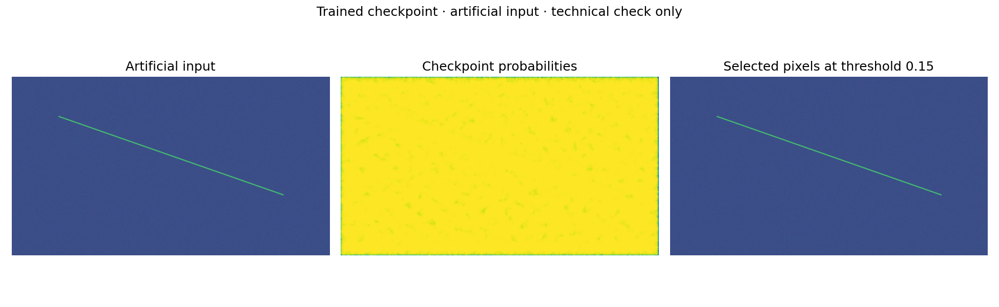

# Supplied thesis checkpoint

The author supplied `model.pt` separately after the portfolio cleanup. The weights
are not included in Git. Its SHA-256 is
`7b2dd9c1aab68114a7b571d225cf52cfda0cd0569dc44f4fc4eb096564cb82c3`.

## Verified properties

- `SkipNet(base=16)`, with 1,842,850 registered parameters (including inactive layers).
- Stored epoch: **15**, consistent with the thesis-selected epoch.
- All state-dictionary keys match strictly, and all parameters/buffers are finite.
- CPU inference on a batch of shape `1 × 1 × 576 × 1024` produces finite logits
  of the same shape, using an artificial native-resolution frame downsampled by four.
- The historical payload contains model, epoch, model state, optimizer state and loss.
- A plain state-dictionary export was also loaded successfully. Unit tests check
  bit-identical inference between plain and historical payloads on synthetic tensors.

See the [machine-readable check report](verification/checkpoint-report.json).
Agreement of architecture and epoch does not independently reproduce the thesis
results or establish the original split, training settings or dataset provenance.

## Run locally

The checkpoint example requires PyTorch 2.6 or newer; verification used 2.7.1 CPU.
Place the separately supplied checkpoint in a local directory, then run:

```bash
python examples/checkpoint_demo.py /path/to/model.pt
# Optionally export just the model weights, without optimizer/model Python objects:
python examples/checkpoint_demo.py /path/to/model.pt --export-weights saved_models/thesis_state_dict.pt
# The plain weights can be used with the same script:
python examples/checkpoint_demo.py saved_models/thesis_state_dict.pt
```

The script uses `weights_only=True` with a fixed list of known project and PyTorch
classes to read the historical payload. It does not import arbitrary globals
requested by a file. It reconstructs a fresh model from the state dictionary,
checks finiteness, uses evaluation mode, and runs under `inference_mode()`.
Output is written under `tmp/checkpoint_demo/`, which is ignored by Git.

## What the artificial example shows



This deliberately simple artificial line plus Gaussian noise is neither detector
data nor a validated detector simulation. At threshold 0.15 the supplied model
selects approximately 99.9995% of this artificial frame. This is **not** evidence
of good segmentation, and is not comparable to the thesis pixel-retention result.
The illustration is retained as an honest technical diagnostic, not a replacement
for real examples. Synthetic-image parameters were not tuned to produce an
attractive model response.

No physics metrics or hardware performance benchmark are inferred from this run.
Original-resolution noisy frames, matched signal-count maps, event IDs and split
membership are still required to validate energy retention and reproduce thesis
case studies. Existing historical figures remain the available physics examples.
