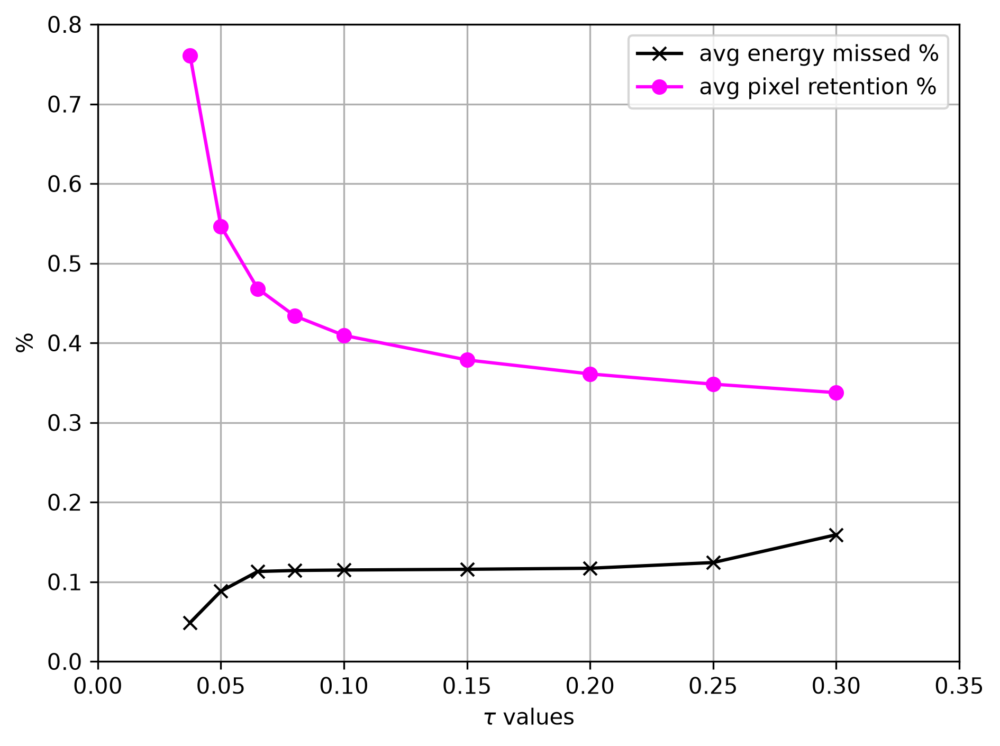

# Results and diagnostics

## Threshold tradeoff

Exported unchanged from the recorded threshold-sweep output in
[`metrics.ipynb`](../metrics.ipynb), cell beginning `# ottimizzazione soglia`.
The plot illustrates the engineering tradeoff: increasing the threshold reduces
retained pixels but risks excluding more signal. It is a historical notebook
artifact, not a newly computed curve. Its checkpoint/split provenance must be
verified before treating it as an independent reproduction of thesis Figure 4.3.

## Cases to examine

The thesis discusses both successful and unsuccessful reconstructions:

| Thesis frame | Observation | Reference |
| --- | --- | --- |
| 816 | Extremely weak 1 keV low-gain event; all signal missed | §4.7.1, Figures 4.6–4.7 |
| 741 | Long low-gain track; about 2.98% missed in its weak tail | §4.7.2, Figures 4.8–4.9 |
| 762 | Long low-gain track; about 1.08% missed | Appendix A |
| 824 | Weak 1 keV low-gain event successfully recovered | Appendix A |

These are references to thesis numbering, not a guarantee that a legacy notebook's
current file index addresses the same event. The thesis PDF is not redistributed.
The original notebooks retain additional qualitative figures. Real-data examples
in `midas_test.ipynb` have no quantitative ground-truth validation.

For a fresh illustration that requires no external data, run the synthetic
walkthrough. Its randomly initialized network only demonstrates the mechanics.
